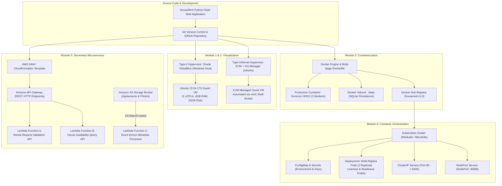
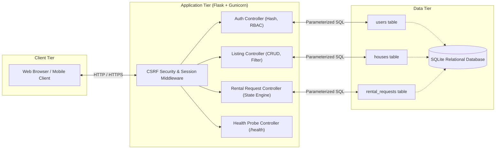

# HouseRent - System Architecture & Evolution Across Syllabus Modules

This document provides a comprehensive architectural breakdown of the **HouseRent – House Rental Management System**, tracing its progression across all five modules of the syllabus: **Virtualization, Virtualization Automation, Docker Containerization, Kubernetes Orchestration, and AWS Serverless Architecture**.

---

## 1. Overall Architectural Workflow

The application serves as a consistent microproject implemented across five progressive paradigms of modern computing infrastructure:

---

## 2. Infrastructure Comparison Matrix

| Dimension | Native Host (Windows) | Module 1: VirtualBox | Module 2: KVM/QEMU | Module 3: Docker | Module 4: Kubernetes | Module 5: AWS Serverless |
| :--- | :--- | :--- | :--- | :--- | :--- | :--- |
| **Isolation Level** | None (Process level) | Full hardware emulation (Type-2) | Hardware-assisted kernel (Type-1/Hybrid) | OS-level kernel namespaces & cgroups | Container grouping & network namespace | Ephemeral execution sandbox (MicroVM / Firecracker) |
| **Startup Time** | Instant (<1s) | Slow (30–60s) | Moderate (15–30s) | Fast (1–3s) | Fast per Pod (2–5s) | Sub-second cold start (100–300ms) |
| **Resource Overhead** | Minimal | High (Guest OS duplicates kernel & RAM) | Moderate | Very Low (Shared host Linux kernel) | Low per container, moderate cluster plane | Zero idle resource consumption (Pay-per-request) |
| **Portability** | OS-dependent | VM image (.ova / .vdi, 5-20 GB) | Disk image (.qcow2, 5-20 GB) | Standard OCI image (~150 MB) | Declarative YAML manifests | CloudFormation / SAM YAML |
| **Scaling** | Manual | Heavyweight VM cloning | Automated `virt-clone` script | Multi-container compose | Automated replica scaling (`kubectl scale`) | Auto-scales from 0 to 1,000s of requests |

---

## 3. Application Component Design

---

## 4. State Management & Database Persistence Across Modules

A foundational concept for computer science students is **Statefulness vs. Statelessness**:

1. **Local Development (Windows):**
   - SQLite file stored at `database/houserent.db`.
   - Single application process connects directly via file locks.

2. **Docker Single Container:**
   - Container filesystems are ephemeral (erased on container removal).
   - Solution: Host volume mapping (`./data:/app/data`) mounts the host folder into the container, preserving database records between restarts.

3. **Kubernetes Multi-Replica Challenge (Critical Viva Topic):**
   - If a Kubernetes Deployment scales to 2 or 4 replicas, each pod has its own container filesystem.
   - If each pod uses an independent local SQLite file, Pod A cannot see records written by Pod B.
   - **Production Remedy:** In production, cloud applications decouple compute from state by using a centralized relational database service (e.g., PostgreSQL, Amazon RDS, Google Cloud SQL) or a distributed storage volume (`ReadWriteMany` PVC backed by NFS or Ceph).
   - In our educational lab, we demonstrate scaling with health probes while highlighting this exact architectural boundary.

4. **Serverless (AWS Lambda):**
   - Lambda functions are completely stateless; their execution context is ephemeral and disposed of after idle periods.
   - Therefore, our serverless demonstration operates either via API validation and mock catalogs or connects to cloud-native databases (such as Amazon DynamoDB or Amazon RDS Aurora Serverless).
